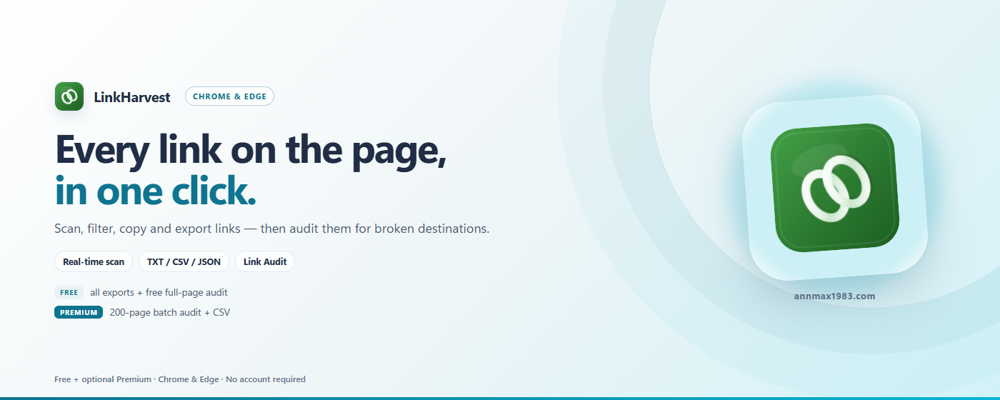

# LinkHarvest — Link Extractor & Scanner

[English](README.md) | [中文](languages/README_zh.md) | [Español](languages/README_es.md) | [Deutsch](languages/README_de.md) | [日本語](languages/README_ja.md) | [Français](languages/README_fr.md)

A lightweight browser extension that extracts all hyperlinks from any webpage, with smart filtering, TXT / CSV / JSON export and an optional link audit.

> Chrome · Edge · Firefox · Manifest V3 · No tracking · Local-only data

---

## Why LinkHarvest?

Most link extraction tools are online services that require uploading page content. LinkHarvest runs entirely in your browser — no data leaves your device.

| Advantage | Detail |
|-----------|--------|
| 🔍 **One-Click Scan** | Extract all `<a>` tag links from the current page — including open shadow roots and nested same-origin iframes; cross-origin iframes are scanned frame by frame |
| 🖼️ **Asset Coverage** | Optional switch also collects `img`, `script`, stylesheets, icons, `iframe` and media sources, so a 404 image or a dead script shows up instead of hiding behind a healthy `<a>` |
| 🏷️ **rel Attributes** | Records `rel` on every link and surfaces `nofollow` / `sponsored` / `ugc`, plus flags `target="_blank"` without `rel="noopener"` |
| 📡 **Real-Time DOM Monitor** | Picks up links added while you scroll (SPA, infinite scroll) |
| 🔎 **Smart Filter** | Keyword include/exclude filters, column sorting; filter anchor & JS pseudo-links; distinguish internal/external; **dofollow-only** view for external link audits |
| 💾 **Saved Filter Presets** | Name the current filter combination and reuse it in one click (stored locally) |
| 📋 **Multi-Format Copy** | Copy filtered links as plain URLs, Markdown, HTML `<a>` list or JSON Lines (free) |
| 🌐 **Open in Tabs** | Open filtered links in background tabs with an adjustable delay (free) |
| 🖱️ **Context Menu** | Right-click any page → "Extract page links", no popup needed |
| 🔢 **Occurrence Count** | Tracks how many times each URL appears on the page |
| 📥 **JSON / TXT Export** | Structured JSON file & plain URL list (free) |
| 📥 **CSV Export** | UTF-8 BOM encoding — compatible with Excel/WPS (free) |
| 🩺 **Link Audit** | Checks HTTP status of every link on the page and flags broken, blocked, redirected and unreachable URLs, plus dead anchors (a `#fragment` with no matching id) and slow links (2 s or longer) — free and unlimited, including the CSV report (⭐ Premium: batch audit across many pages) |
| 🎯 **No False Positives** | Servers that answer `HEAD` with 404 while `GET` works fine are re-verified with `GET`, so a working link is never reported as dead |
| 🚦 **Polite Crawling** | Outbound requests are rate-limited and back off automatically on HTTP 429, so auditing a large page doesn't look like an attack |
| 🔒 **Local-Only Data** | Scan results live in browser memory only (cleared when the tab closes); saved filter presets and UI preferences stay in this browser's localStorage and are never uploaded |
| 🌍 **Multi-Language** | Supports English, Chinese, Japanese, German, Spanish, French |
| 🌙 **Dark Mode** | Follows your system theme automatically |
| ⚡ **Lightweight** | Pure vanilla JavaScript, zero dependencies, < 100KB package |
| 🏗️ **Manifest V3** | Uses `activeTab` + `scripting` + `storage` + `contextMenus` — minimal permissions; site access is optional and requested at runtime only for the origins actually being checked |

---

## Free vs Premium

| Plan | Features |
|------|----------|
| **Free** | Scan links (including open shadow roots and iframes), optional asset scanning (images, scripts, stylesheets, iframes, media), rel / nofollow / noopener detection, real-time DOM monitor, search & filter, saved filter presets, multi-format copy, open in tabs, TXT / JSON / CSV export, dark mode, **full single-page Link Audit with dead-anchor and slow-link detection, plus the CSV report — unlimited** |
| **⭐ Premium** | **Batch audit** — check every link across up to 200 pages in one run, fed from a pasted URL list or a sitemap, with cross-page anchor validation and a combined CSV report |

The whole single-page workflow is free forever — including the link audit and its report, for pages of any size. The paid tier adds **scope**: auditing many pages at once. It requires a VKT Premium license — a one-time purchase that supports development.

- 🛒 Get a license: `https://annmax1983.com/checkout?plugin=linkharvest`
- ⚙ Activate it: open the LinkHarvest popup → click the **⚙** button → enter your license key.

> License activation is **optional**. The free tier works fully without it — no account, no sign-up, no license key required.

---

## Preview

  

---

## Supported Browsers

| Browser | Status | Notes |
|---------|--------|-------|
| Google Chrome | ✅ Fully supported | Manifest V3, Chrome 112+ |
| Microsoft Edge | ✅ Fully supported | Manifest V3 |
| Mozilla Firefox | ✅ Fully supported | Manifest V3, Firefox 140+ (desktop) |
| Other Chromium-based browsers | ✅ Should work | Manifest V3 |

> **Firefox note:** every feature works the same way. Optional site access for Link Audit is requested at runtime through Firefox's own permission prompt, and it can be revoked later in *Add-ons Manager → Permissions*.

---

## Installation

| Store | Link |
|---|---|
| Chrome Web Store | [Install for Chrome](https://chromewebstore.google.com/detail/cnkbdmjkfnlgpjehaogliipehjaibojn) |
| Microsoft Edge Add-ons | [Install for Edge](https://microsoftedge.microsoft.com/addons/detail/abfpbiilibfniidobemeffponimgdaff) |
| Firefox Add-ons (AMO) | [Install for Firefox](https://addons.mozilla.org/firefox/addon/linkharvest-link/) |

> Install only from the official stores above — avoid third-party download sites.

---

## Usage

1. **Open the target webpage** and wait for dynamic content to load
2. **Click the LinkHarvest icon** in your browser toolbar
3. **Enable DOM Monitor** (optional) — for pages with infinite scroll or lazy-loaded links
4. **Click "Scan Page Links"** — all links are extracted instantly
5. **View full list** — opens a dedicated results page with table view
6. **Search & Filter** — use the search box, keyword include/exclude filters, and column sorting to narrow results
   - 💾 Save this filter combination as a named preset (💾) and reuse it in one click later
   - 🌐 Open the filtered links in background tabs (🌐) with an adjustable delay
7. **Copy links** — copy filtered links as plain URLs, Markdown, HTML or JSON Lines (free)
8. **Export TXT / JSON / CSV** — save filtered links as a plain text, JSON or CSV file (free)
9. **Run Link Audit** — check the HTTP status of every link on the page and see broken, blocked, redirected and unreachable URLs, plus dead anchors and slow links (2 s or longer); free and unlimited, with a CSV report
   - 🖼 Enable **Include assets** to also check images, scripts, stylesheets, icons, iframes and media on the same page
10. **Run a batch audit** (Premium) — switch to 🗂 **Batch audit**, paste a list of page URLs or point it at a sitemap, and check every link across up to 200 pages in one run, including anchors that point into other pages of the same batch

---

## Collected Fields

| Field | Description |
|-------|-------------|
| `linkText` | Link display text (cleaned); asset files fall back to the file name |
| `href` | Full absolute URL |
| `target` | `_blank` / `_self` |
| `category` | anchor / javascript / protocol / asset / normal |
| `kind` | `link` for `<a>` elements, `asset` for images, scripts, stylesheets, iframes and media |
| `assetType` | Assets only: image / script / style / frame / media |
| `rel` | The link's `rel` attribute as an array (`nofollow`, `sponsored`, `ugc`, `noopener`, …) |
| `noopenerMissing` | `true` when `target="_blank"` has no `rel="noopener"` / `noreferrer` |
| `anchorId` / `anchorOk` | Anchor links only: the fragment id and whether an element with that id exists on the page (missing targets are flagged as dead anchors) |
| `isInternal` | Whether the link is same-origin |
| `count` | How many times the URL appears on the page |

---

## Privacy

- **activeTab** — Grants access only when you actively click the extension icon
- **scripting** — Used to inject the link collection script into the current page
- **storage** — Stores scan results temporarily for the results page; cleared when the scanned tab is closed
- **Local preferences** — Saved filter presets and the tab-opening delay live in this browser's `localStorage`; they never leave your device and disappear when you clear the extension's site data
- **contextMenus** — Adds a right-click "Extract page links" menu item; reads no data itself
- **Optional site access (Link Audit)** — When you start a link audit, the browser asks for permission to contact the sites of the links being checked (only those origins, not all sites). Checks go directly from your browser to each URL (HTTP HEAD/GET, no cookies); only the status code, redirect target and response time are kept in the results page memory. No page content is read or uploaded.
- **License (optional)** — Only if you activate a paid license: a random install identifier + browser metadata is sent to `api.annmax1983.com` to activate/validate the license. This never includes your scan data, browsing history, or personal data.
- No all-sites access by default — optional site access is requested only when you start Link Audit, and scan data stays local
- No external network requests except the optional license check and the Link Audit checks you start yourself
- No browsing history access, no user tracking, no data upload
- [Privacy Policy](privacy-policy.html)

---

## Copyright Disclaimer

This extension only reads publicly rendered hyperlink elements (`<a>` tags) from web pages for the user's convenience. All text, images and content copyright of the website belong to the original publisher. Extracting links does not grant users any copyright authorization for the website content.

---

## Source Code Notice

> ⚠️ **This repository does not publish source code.** It only contains usage documentation, release notes and support resources. The extension is distributed exclusively through the Chrome Web Store, Microsoft Edge Add-ons and Firefox Add-ons (AMO); no offline installation packages or end-user source code are provided.

---

## License

Copyright © 2026 LinkHarvest. All rights reserved.

---

## Links

- **Official website:** https://annmax1983.com/
- **This extension:** https://annmax1983.com/extensions/linkharvest
- **Privacy policy:** https://annmax1983.com/privacy
- **Contact:** support@annmax1983.com
- **☕ Support this project (Ko-fi):** https://ko-fi.com/annmax?ref=linkharvest
