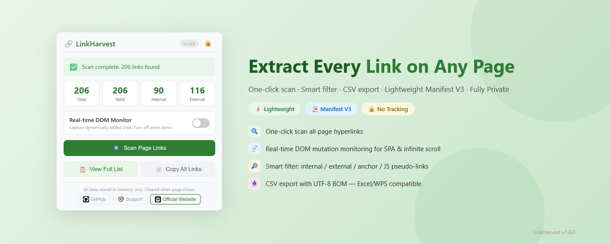

# LinkHarvest — Link Extractor & Scanner

[English](README.md) | [中文](languages/README_zh.md) | [Español](languages/README_es.md) | [Deutsch](languages/README_de.md) | [日本語](languages/README_ja.md) | [Français](languages/README_fr.md)

A lightweight browser extension that extracts all hyperlinks from any webpage, with smart filtering, search, CSV / JSON export, and an optional link audit.

> Chromium-based · Manifest V3 · No tracking · Local-only data

---

## Why LinkHarvest?

Most link extraction tools are online services that require uploading page content. LinkHarvest runs entirely in your browser — no data leaves your device.

| Advantage | Detail |
|-----------|--------|
| 🔍 **One-Click Scan** | Extract all `<a>` tag links from the current page |
| 📡 **Real-Time DOM Monitor** | MutationObserver captures dynamically added links (SPA, infinite scroll) |
| 🔎 **Smart Filter** | Keyword include/exclude filters, column sorting; filter anchor & JS pseudo-links; distinguish internal/external |
| 💾 **Saved Filter Presets** | Name the current filter combination and reuse it in one click (stored locally) |
| 📋 **Multi-Format Copy** | Copy filtered links as plain URLs, Markdown, HTML `<a>` list or JSON Lines (free) |
| 🌐 **Open in Tabs** | Open filtered links in background tabs with an adjustable delay (free) |
| 🖱️ **Context Menu** | Right-click any page → "Extract page links", no popup needed |
| 🔢 **Occurrence Count** | Tracks how many times each URL appears on the page |
| 📥 **JSON / TXT Export** | Structured JSON file & plain URL list (free) |
| 📥 **CSV Export** | UTF-8 BOM encoding — compatible with Excel/WPS (free) |
| 🩺 **Link Audit** | Checks HTTP status of the filtered links and flags broken, blocked, redirected and unreachable URLs; free preview of 100 links per run (⭐ Premium: up to 2,000 links + CSV report) |
| 🔒 **Local-Only Data** | Scan results live in browser memory only (cleared when the page closes); saved filter presets and UI preferences stay in this browser's localStorage and are never uploaded |
| 🌍 **Multi-Language** | Supports English, Chinese, Japanese, German, Spanish, French |
| 🌙 **Dark Mode** | Follows your system theme automatically |
| ⚡ **Lightweight** | Pure vanilla JavaScript, zero dependencies, < 100KB package |
| 🏗️ **Manifest V3** | Uses `activeTab` + `scripting` + `storage` + `contextMenus` — minimal permissions; site access for Link Audit is optional and requested at runtime per checked site |

---

## Free vs Premium

| Plan | Features |
|------|----------|
| **Free** | Scan links, real-time DOM monitor, search & filter, saved filter presets, multi-format copy, open in tabs, TXT / JSON / CSV export, dark mode, Link Audit preview (100 links per run) |
| **⭐ Premium** | Full Link Audit — up to 2,000 links per run and export a CSV audit report with status codes, redirect targets and response times |

All core features (scan, filter, copy, export) and the **Link Audit preview** are free forever. The **full Link Audit and audit report** require a VKT Premium license — a one-time purchase that supports development.

- 🛒 Get a license: `https://www.annmax1983.com/checkout.html?plugin=linkharvest`
- ⚙ Activate it: open the LinkHarvest popup → click the **⚙** button → enter your license key.

> License activation is **optional**. The free tier works fully without it — no account, no sign-up, no license key required.

---

## Preview

  

---

## Supported Browsers

| Browser | Status |
|---------|--------|
| Google Chrome | ✅ Fully supported |
| Microsoft Edge | ✅ Fully supported |
| Other Chromium-based browsers | ✅ Should work |

---

## Installation

1. Open your browser's extension page:
   - **Chrome**: `chrome://extensions/`
   - **Edge**: `edge://extensions/`
2. Enable **Developer mode** (top-right toggle)
3. Click **Load unpacked** and select the project folder
4. Click the 🔗 LinkHarvest icon in your toolbar to start

---

## Usage

1. **Open the target webpage** and wait for dynamic content to load
2. **Click the LinkHarvest icon** in your browser toolbar
3. **Enable DOM Monitor** (optional) — for pages with infinite scroll or lazy-loaded links
4. **Click "Scan Page Links"** — all links are extracted instantly
5. **View full list** — opens a dedicated results page with table view
6. **Search & Filter** — use the search box, keyword include/exclude filters, and column sorting to narrow results
   - 💾 Save this filter combination as a named preset (💾) and reuse it in one click later
   - 🌐 Open the filtered links in background tabs (🌐) with an adjustable delay
7. **Copy links** — copy filtered links as plain URLs, Markdown, HTML or JSON Lines (free)
8. **Export TXT / JSON / CSV** — save filtered links as a plain text, JSON or CSV file (free)
9. **Run Link Audit** — check the HTTP status of filtered links and see broken, blocked, redirected and unreachable URLs; the free preview covers 100 links per run, Premium covers up to 2,000 and can export a CSV report

---

## Collected Fields

| Field | Description |
|-------|-------------|
| `linkText` | Link display text (cleaned) |
| `href` | Full absolute URL |
| `target` | `_blank` / `_self` |
| `category` | anchor / javascript / protocol / normal |
| `isInternal` | Whether the link is same-origin |
| `count` | How many times the URL appears on the page |

---

## Privacy

- **activeTab** — Grants access only when you actively click the extension icon
- **scripting** — Used to inject the link collection script into the current page
- **storage** — Stores scan results temporarily for the results page; cleared when the scanned tab is closed
- **Local preferences** — Saved filter presets and the tab-opening delay live in this browser's `localStorage`; they never leave your device and disappear when you clear the extension's site data
- **contextMenus** — Adds a right-click "Extract page links" menu item; reads no data itself
- **Optional site access (Link Audit)** — When you start a link audit, the browser asks for permission to contact the sites of the links being checked (only those origins, not all sites). Checks go directly from your browser to each URL (HTTP HEAD/GET, no cookies); only the status code, redirect target and response time are kept in the results page memory. No page content is read or uploaded.
- **License (optional)** — Only if you activate a paid license: a random install identifier + browser metadata is sent to `api.annmax1983.com` to activate/validate the license. This never includes your scan data, browsing history, or personal data.
- No all-sites access by default — optional site access is requested only when you start Link Audit, and scan data stays local
- No external network requests except the optional license check and the Link Audit checks you start yourself
- No browsing history access, no user tracking, no data upload
- [Privacy Policy](privacy-policy.html)

---

## Copyright Disclaimer

This extension only reads publicly rendered hyperlink elements (`<a>` tags) from web pages for the user's convenience. All text, images and content copyright of the website belong to the original publisher. Extracting links does not grant users any copyright authorization for the website content.

---

## Source Code Notice

> ⚠️ **This repository does not publish source code.** It contains only usage documentation, release notes, and support resources. The extension is distributed exclusively through the Chrome Web Store. No offline installation packages or end-user source code are provided.

---

## License

Copyright © 2026 LinkHarvest. All rights reserved.
