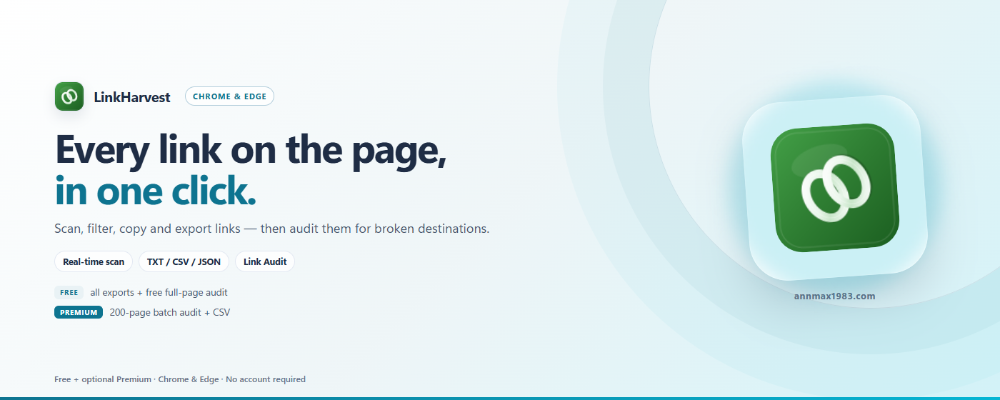

# LinkHarvest — Link-Extraktor & Scanner

[English](../README.md) | [中文](README_zh.md) | [Español](README_es.md) | Deutsch | [日本語](README_ja.md) | [Français](README_fr.md)

Eine schlanke Browser-Erweiterung, die alle Hyperlinks von jeder Webseite extrahiert — mit intelligentem Filter, Suche, TXT-/CSV-/JSON-Export und optionaler Link-Prüfung.

> Chrome / Edge / Firefox · Manifest V3 · Kein Tracking · Nur lokale Daten

---

## Warum LinkHarvest?

Die meisten Link-Extraktions-Tools sind Online-Dienste, die den Seiteninhalt hochladen müssen. LinkHarvest läuft komplett in deinem Browser — keine Daten verlassen dein Gerät.

| Vorteil | Details |
|---------|---------|
| 🔍 **Ein-Klick-Scan** | Alle `<a>`-Links der aktuellen Seite — inklusive offener Shadow Roots und verschachtelter Same-Origin-iframes; Cross-Origin-iframes werden Frame für Frame geprüft |
| 🖼️ **Ressourcen-Erfassung** | Optionaler Schalter erfasst zusätzlich `img`, `script`, Stylesheets, Icons, `iframe` und Medien — ein defektes Bild oder ein 404-Skript bleibt nicht länger hinter einem gesunden `<a>` verborgen |
| 🏷️ **rel-Attribute** | Zeichnet `rel` bei jedem Link auf und zeigt `nofollow` / `sponsored` / `ugc`; markiert `target="_blank"` ohne `rel="noopener"` |
| 📡 **Echtzeit-DOM-Überwachung** | Erfasst auch nachträglich hinzugefügte Links (SPA, Infinite Scroll) |
| 🔎 **Intelligenter Filter** | Keyword Ein-/Ausschluss-Filter, Spaltensortierung; Anchor & JS-Pseudo-Links filtern; intern/extern unterscheiden; **Nur-dofollow**-Ansicht für externe Link-Audits |
| 💾 **Gespeicherte Filter** | Aktuelle Filterkombination benennen und später per Klick erneut anwenden (lokal gespeichert) |
| 📋 **Kopieren in mehreren Formaten** | Gefilterte Links als URL-Liste, Markdown, HTML-`<a>`-Liste oder JSON Lines kopieren (kostenlos) |
| 🌐 **In Tabs öffnen** | Gefilterte Links nacheinander in Hintergrund-Tabs öffnen, Verzögerung einstellbar (kostenlos) |
| 🖱️ **Kontextmenü** | Rechtsklick auf beliebige Seite → „Seitenlinks extrahieren", kein Popup nötig |
| 🔢 **Häufigkeitszähler** | Zählt, wie oft jede URL auf der Seite erscheint |
| 📥 **JSON-/TXT-Export** | Strukturierte JSON-Datei & URL-Liste (kostenlos) |
| 📥 **CSV-Export** | UTF-8 BOM-Kodierung — kompatibel mit Excel/WPS (kostenlos) |
| 🩺 **Link-Prüfung** | Prüft den HTTP-Status der Links und markiert defekte, blockierte, weitergeleitete und nicht erreichbare Links, dazu tote Anker (`#fragment` ohne passende id) und langsame Links (ab 2 s); alle Links einer Seite kostenlos und unbegrenzt inkl. CSV-Bericht (⭐ Pro: Stapelprüfung über bis zu 200 Seiten + ein gemeinsamer CSV-Bericht) |
| 🎯 **Keine Fehlalarme** | Server, die auf `HEAD` mit 404 antworten, während `GET` funktioniert, werden mit `GET` nachgeprüft — ein funktionierender Link wird nie als tot gemeldet |
| 🚦 **Rücksichtsvolles Crawling** | Ausgehende Anfragen sind ratenbegrenzt und warten bei HTTP 429 automatisch ab, damit eine große Prüfung nicht wie ein Angriff aussieht |
| 🔒 **Nur lokale Daten** | Scan-Ergebnisse nur im Browser-Speicher (beim Schließen der Seite gelöscht); gespeicherte Filter und Oberflächen-Einstellungen liegen im localStorage dieses Browsers und werden nie hochgeladen |
| 🌍 **Mehrsprachig** | Unterstützt Englisch, Chinesisch, Japanisch, Deutsch, Spanisch, Französisch |
| 🌙 **Dunkler Modus** | Folgt automatisch dem Systemfarbschema |
| ⚡ **Leichtgewichtig** | Reines Vanilla JavaScript, null Abhängigkeiten, < 100KB Paket |
| 🏗️ **Manifest V3** | Verwendet `activeTab` + `scripting` + `storage` + `contextMenus` — minimale Berechtigungen |

---

## Kostenlos vs. Pro

| Plan | Funktionen |
|------|-----------|
| **Kostenlos** | Links scannen (inkl. Shadow Roots und iframes), optionale Ressourcen-Erfassung (Bilder, Skripte, Stylesheets, iframes, Medien), rel-/nofollow-/noopener-Erkennung, Echtzeit-DOM-Überwachung, Suche & Filter, gespeicherte Filter, Kopieren in mehreren Formaten, in Tabs öffnen, TXT-/JSON-/CSV-Export, dunkler Modus, Link-Prüfung aller Links einer Seite (unbegrenzt, inkl. CSV-Bericht) |
| **⭐ Pro** | Stapelprüfung — prüft alle Links auf bis zu 200 Seiten pro Durchlauf, aus einer eingefügten URL-Liste oder einer Sitemap, und exportiert einen gemeinsamen CSV-Bericht mit Statuscodes, Weiterleitungszielen und Antwortzeiten; Anker, die auf andere Seiten desselben Durchlaufs zeigen, werden ebenfalls geprüft |

Alle Kernfunktionen, der **TXT-/JSON-/CSV-Export** und die **Link-Prüfung einer einzelnen Seite** (inkl. CSV-Bericht) sind für immer kostenlos. Die **Stapelprüfung über viele Seiten** erfordert eine VKT Pro-Lizenz.

- 🛒 Lizenz erhalten: `https://annmax1983.com/checkout?plugin=linkharvest`
- ⚙ Aktivieren: LinkHarvest Popup öffnen → **⚙**-Button klicken → Lizenzschlüssel eingeben.

> Die Lizenzaktivierung ist **optional**. Die kostenlose Stufe funktioniert vollständig ohne sie — kein Konto, keine Anmeldung, kein Lizenzschlüssel erforderlich.

---

## Vorschau

  

---

## Unterstützte Browser

| Browser | Status |
|---------|--------|
| Google Chrome | ✅ Vollständig unterstützt |
| Microsoft Edge | ✅ Vollständig unterstützt |
| Mozilla Firefox | ✅ Vollständig unterstützt |
| Andere Chromium-basierte Browser | ✅ Sollte funktionieren |

> **Firefox-Hinweis:** Website-Berechtigungen werden über den nativen Firefox-Dialog bestätigt und lassen sich jederzeit im Add-on-Manager widerrufen. Die übrigen Funktionen verhalten sich wie unter Chrome / Edge.

---

## Installation

| Store | Link |
|---|---|
| Chrome Web Store | [In Chrome installieren](https://chromewebstore.google.com/detail/cnkbdmjkfnlgpjehaogliipehjaibojn) |
| Microsoft Edge Add-ons | [In Edge installieren](https://microsoftedge.microsoft.com/addons/detail/abfpbiilibfniidobemeffponimgdaff) |
| Firefox-Add-ons (AMO) | [Für Firefox installieren](https://addons.mozilla.org/firefox/addon/linkharvest-link/) |

> Installieren Sie nur über die offiziellen Stores oben – meiden Sie Download-Seiten Dritter.

---

## Verwendung

1. **Ziel-Webseite öffnen** und warten, bis dynamische Inhalte geladen sind
2. **Auf das LinkHarvest-Symbol klicken** in der Browser-Toolbar
3. **DOM-Überwachung aktivieren** (optional) — für Seiten mit Infinite Scroll oder Lazy-Loaded Links
4. **Auf „Seitenlinks scannen" klicken** — alle Links werden sofort extrahiert
5. **Vollständige Liste anzeigen** — öffnet eine dedizierte Ergebnisseite mit Tabellenansicht
6. **Suchen & Filtern** — Suchbox, Keyword Ein-/Ausschluss-Filter und Spaltensortierung verwenden, um Ergebnisse einzugrenzen
   - 💾 Filterkombination als benannten Preset speichern und später per Klick erneut anwenden
   - 🌐 Gefilterte Links nacheinander in Hintergrund-Tabs öffnen (Verzögerung einstellbar)
7. **Kopieren oder exportieren** — Links als URL-Liste, Markdown, HTML oder JSON Lines kopieren (kostenlos), TXT / JSON / CSV mit Häufigkeitszähler exportieren (kostenlos)
8. **Link-Prüfung starten** — prüft den HTTP-Status der gefilterten Links und findet defekte, blockierte, weitergeleitete und nicht erreichbare Links; eine Seite ist kostenlos und unbegrenzt, Pro ergänzt die Stapelprüfung über bis zu 200 Seiten mit einem gemeinsamen CSV-Bericht

---

## Erfasste Felder

| Feld | Beschreibung |
|------|--------------|
| `linkText` | Link-Anzeigetext (bereinigt) |
| `href` | Vollständige absolute URL |
| `target` | `_blank` / `_self` |
| `category` | anchor / javascript / protocol / asset / normal |
| `kind` | `link` für `<a>`-Elemente, `asset` für Bilder, Skripte, Stylesheets, iframes und Medien |
| `assetType` | Nur Assets: image / script / style / frame / media |
| `rel` | Das `rel`-Attribut des Links als Array (`nofollow`, `sponsored`, `ugc`, `noopener`, …) |
| `noopenerMissing` | `true`, wenn `target="_blank"` kein `rel="noopener"` / `noreferrer` hat |
| `anchorId` / `anchorOk` | Nur Ankerlinks: die Fragment-ID und ob ein Element mit dieser ID auf der Seite existiert |
| `isInternal` | Ob der Link same-origin ist |
| `count` | Wie oft die URL auf der Seite erscheint |

---

## Datenschutz

- **activeTab** — Gewährt Zugriff nur bei aktivem Klick auf das Erweiterungssymbol
- **scripting** — Wird verwendet, um das Link-Sammelskript in die aktuelle Seite zu injizieren
- **storage** — Speichert Scanergebnisse temporär für die Ergebnisseite; wird beim Schließen des gescannten Tabs gelöscht
- **contextMenus** — Fügt ein Rechtsklick-„Seitenlinks extrahieren"-Menü hinzu; liest selbst keine Daten
- **Optionaler Website-Zugriff (Link-Prüfung)** — Der Browser fragt beim Start einer Prüfung nach der Berechtigung. Anfragen gehen direkt von deinem Browser an jede URL (HTTP HEAD/GET, ohne Cookies); nur Statuscode, Weiterleitungsziel und Antwortzeit werden im Speicher gehalten. Seiteninhalte werden weder gelesen noch hochgeladen.
- **Lizenz (optional)** — Nur bei Aktivierung einer kostenpflichtigen Lizenz: Lizenzschlüssel und eine zufällige Installationskennung + Browser-Metadaten werden an `api.annmax1983.com` gesendet, um die Lizenz zu aktivieren/validieren. Dies enthält nie deine Scandaten, deinen Browserverlauf oder persönliche Daten.
- Kein Zugriff auf alle Websites standardmäßig — der Zugriff ist optional und wird nur beim Start der Link-Prüfung angefordert
- Keine externen Netzwerk-Anfragen außer der optionalen Lizenzvalidierung und den von dir gestarteten Prüfungen
- Kein Zugriff auf den Browserverlauf, kein Nutzertracking, kein Datenupload
- [Datenschutzerklärung](privacy-policy.html)

---

## Urheberrechtshinweis

Diese Erweiterung liest nur öffentlich gerenderte Hyperlink-Elemente (`<a>`-Tags) von Webseiten für die Bequemlichkeit des Nutzers. Alle Text-, Bild- und Inhaltsrechte der Website gehören dem jeweiligen Herausgeber. Das Extrahieren von Links gewährt Nutzern keine Urheberrechtslizenz an Website-Inhalten.

---

## Hinweis zum Quellcode

> ⚠️ **Dieses Repository dient ausschließlich der Projektpräsentation — der vollständige Quellcode wird hier nicht veröffentlicht.** Es enthält nur die Nutzungsdokumentation, die Release-Notizen und Support-Informationen zur Erweiterung.

> 📥 **Installation ausschließlich über die offiziellen Browser-Stores:** Chrome Web Store · Microsoft Edge Add-ons · Firefox-Add-ons (AMO). Von hier werden keine Offline-Installer verteilt.

---

## Lizenz

Copyright © 2026 LinkHarvest. Alle Rechte vorbehalten.

Diese Software ist proprietär und quellgeschlossen. Ohne vorherige schriftliche Genehmigung des Autors ist das Dekompilieren, Reverse-Engineering, Knacken, Verändern, Neuverpacken, Weiterverbreiten oder Weiterverkaufen der Software (ganz oder teilweise) streng untersagt.

---

## Links

- **Offizielle Website:** https://annmax1983.com/
- **Diese Erweiterung:** https://annmax1983.com/extensions/linkharvest
- **Datenschutz:** https://annmax1983.com/privacy
- **Kontakt:** support@annmax1983.com
- **☕ Projekt unterstützen (Ko-fi):** https://ko-fi.com/annmax?ref=linkharvest
