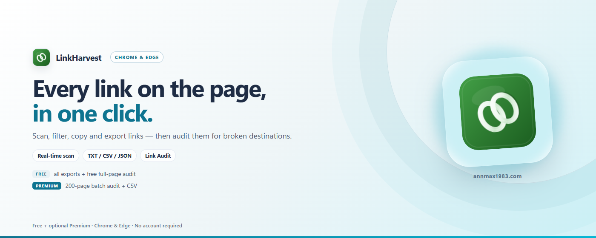

# LinkHarvest — Extractor y escáner de enlaces

[English](../README.md) | [中文](README_zh.md) | Español | [Deutsch](README_de.md) | [日本語](README_ja.md) | [Français](README_fr.md)

Una extensión ligera para el navegador que extrae todos los hipervínculos de cualquier página web, con filtrado inteligente, exportación a TXT / CSV / JSON y revisión de enlaces opcional.

> Chrome / Edge / Firefox · Manifest V3 · Sin rastreo · Datos solo locales

---

## ¿Por qué LinkHarvest?

La mayoría de herramientas de extracción de enlaces son servicios online que requieren subir el contenido de la página. LinkHarvest se ejecuta completamente en tu navegador — tus datos nunca salen de tu dispositivo.

| Ventaja | Detalle |
|---------|--------|
| 🔍 **Escanear con un clic** | Extrae todos los enlaces `<a>` de la página actual, incluidos shadow roots abiertos e iframes anidados del mismo origen; los iframes de otro origen se escanean frame a frame |
| 🖼️ **Detección de recursos** | Un interruptor opcional recoge también `img`, `script`, hojas de estilo, iconos, `iframe` y medios, para que una imagen rota o un script 404 no queden ocultos tras un `<a>` correcto |
| 🏷️ **Atributos rel** | Registra `rel` en cada enlace y muestra `nofollow` / `sponsored` / `ugc`, además de marcar `target="_blank"` sin `rel="noopener"` |
| 📡 **Monitorización DOM en tiempo real** | Captura los enlaces que se añaden al desplazarte (SPA, scroll infinito) |
| 🔎 **Filtrado inteligente** | Filtros por inclusión/exclusión de palabras clave, ordenación por columnas; filtra enlaces ancla y pseudo-enlaces JS; distingue interno/externo; vista **solo dofollow** para auditorías de enlaces externos |
| 💾 **Filtros guardados** | Asigna un nombre a la combinación de filtros actual y reutilízala con un clic (guardado localmente) |
| 📋 **Copia en varios formatos** | Copia los enlaces filtrados como lista de URLs, Markdown, lista HTML `<a>` o JSON Lines (gratis) |
| 🌐 **Abrir en pestañas** | Abre los enlaces filtrados en pestañas de fondo con retardo ajustable (gratis) |
| 🖱️ **Menú contextual** | Clic derecho en cualquier página → "Extraer enlaces de la página", sin necesidad de popup |
| 🔢 **Conteo de apariciones** | Registra cuántas veces aparece cada URL en la página |
| 📥 **Exportación JSON / TXT** | Archivo JSON estructurado y lista de URLs (gratis) |
| 📥 **Exportación CSV** | Codificación UTF-8 BOM — compatible con Excel/WPS (gratis) |
| 🩺 **Revisión de enlaces** | Comprueba el estado HTTP de los enlaces y marca enlaces rotos, bloqueados, redirigidos e inaccesibles, además de anclas muertas (`#fragment` sin id correspondiente) y enlaces lentos (2 s o más); todos los enlaces de una página son gratis y sin límite, con informe CSV gratuito (⭐ Pro: auditoría por lotes de hasta 200 páginas + un informe CSV combinado) |
| 🎯 **Sin falsos positivos** | Los servidores que responden 404 a `HEAD` pero funcionan con `GET` se verifican de nuevo con `GET`, así un enlace vivo nunca se marca como roto |
| 🚦 **Rastreo respetuoso** | Las peticiones salientes están limitadas y se retiran automáticamente ante HTTP 429, para que auditar una página grande no parezca un ataque |
| 🔒 **Datos solo locales** | Los resultados del escaneo solo viven en la memoria del navegador (se borran al cerrar la página); los filtros guardados y las preferencias de interfaz se guardan en el localStorage de este navegador y nunca se suben |
| 🌍 **Multi-idioma** | Soporta inglés, chino, japonés, alemán, español y francés |
| 🌙 **Modo oscuro** | Sigue automáticamente el tema del sistema |
| ⚡ **Ligera** | JavaScript vanilla puro, cero dependencias, paquete de menos de 100 KB |
| 🏗️ **Manifest V3** | Usa `activeTab` + `scripting` + `storage` + `contextMenus` — permisos mínimos |

---

## Gratis vs Pro

| Plan | Funcionalidades |
|------|----------|
| **Gratis** | Escanear enlaces (incluidos shadow roots e iframes), detección opcional de recursos (imágenes, scripts, hojas de estilo, iframes, medios), detección de rel / nofollow / noopener, monitorización DOM en tiempo real, buscar y filtrar, filtros guardados, copia en varios formatos, abrir en pestañas, exportación TXT / JSON / CSV, modo oscuro, revisión de todos los enlaces de una página (sin límite, con informe CSV) |
| **⭐ Pro** | Auditoría por lotes — revisa todos los enlaces de hasta 200 páginas por ejecución, desde una lista de URL pegada o un sitemap; exporta un informe CSV combinado con códigos de estado, destinos de redirección y tiempos de respuesta; también valida las anclas que apuntan a otras páginas del mismo lote |

Todas las funcionalidades principales, la **exportación TXT / JSON / CSV** y la **revisión de enlaces de una sola página** (con informe CSV) son gratuitas para siempre. La **auditoría por lotes en varias páginas** requiere una licencia VKT Pro.

- 🛒 Obtener licencia: `https://annmax1983.com/checkout?plugin=linkharvest`
- ⚙ Activarla: abre el popup de LinkHarvest → haz clic en el botón **⚙** → introduce tu clave de licencia.

> La activación de licencia es **opcional**. El nivel gratuito funciona completamente sin ella — sin cuenta, sin registro, sin clave de licencia.

---

## Vista previa

  

---

## Navegadores compatibles

| Navegador | Estado |
|---------|--------|
| Google Chrome | ✅ Totalmente compatible |
| Microsoft Edge | ✅ Totalmente compatible |
| Mozilla Firefox | ✅ Totalmente compatible |
| Otros navegadores basados en Chromium | ✅ Debería funcionar |

> **Nota sobre Firefox:** Los permisos de sitio se confirman con el aviso nativo de Firefox y pueden revocarse en cualquier momento desde el Administrador de complementos. El resto de funciones se comporta igual que en Chrome / Edge.

---

## Instalación

| Tienda | Enlace |
|---|---|
| Chrome Web Store | [Instalar en Chrome](https://chromewebstore.google.com/detail/cnkbdmjkfnlgpjehaogliipehjaibojn) |
| Complementos de Microsoft Edge | [Instalar en Edge](https://microsoftedge.microsoft.com/addons/detail/abfpbiilibfniidobemeffponimgdaff) |
| Complementos de Firefox (AMO) | [Instalar para Firefox](https://addons.mozilla.org/firefox/addon/linkharvest-link/) |

> Instale solo desde las tiendas oficiales de arriba; evite sitios de descarga de terceros.

---

## Uso

1. **Abre la página web objetivo** y espera a que el contenido dinámico se cargue
2. **Haz clic en el icono de LinkHarvest** en la barra de herramientas de tu navegador
3. **Activa el monitor DOM** (opcional) — para páginas con scroll infinito o enlaces de carga diferida
4. **Haz clic en "Escanear enlaces de la página"** — todos los enlaces se extraen al instante
5. **Ver lista completa** — se abre una página de resultados dedicada con vista de tabla
6. **Buscar y filtrar** — usa el campo de búsqueda, filtros de inclusión/exclusión de palabras clave y ordenación por columnas para reducir los resultados
   - 💾 Guarda esa combinación de filtros como preajuste con nombre y reutilízala con un clic
   - 🌐 Abre los enlaces filtrados en pestañas de fondo con retardo ajustable
7. **Copiar o exportar** — copia enlaces como URLs, Markdown, HTML o JSON Lines (gratis), exporta TXT / JSON / CSV con conteo de apariciones (gratis)
8. **Ejecutar revisión de enlaces** — comprueba el estado HTTP de los enlaces filtrados y detecta enlaces rotos, bloqueados, redirigidos e inaccesibles; una página es gratis y sin límite, Pro añade auditoría por lotes de hasta 200 páginas con un informe CSV combinado

---

## Campos recopilados

| Campo | Descripción |
|-------|-------------|
| `linkText` | Texto visible del enlace (limpiado) |
| `href` | URL absoluta completa |
| `target` | `_blank` / `_self` |
| `category` | anchor / javascript / protocol / asset / normal |
| `kind` | `link` para elementos `<a>`, `asset` para imágenes, scripts, hojas de estilo, iframes y medios |
| `assetType` | Solo recursos: image / script / style / frame / media |
| `rel` | El atributo `rel` del enlace como array (`nofollow`, `sponsored`, `ugc`, `noopener`, …) |
| `noopenerMissing` | `true` cuando `target="_blank"` no tiene `rel="noopener"` / `noreferrer` |
| `anchorId` / `anchorOk` | Solo enlaces ancla: el id del fragmento y si existe un elemento con ese id en la página |
| `isInternal` | Si el enlace es del mismo origen |
| `count` | Cuántas veces aparece la URL en la página |

---

## Privacidad

- **activeTab** — Concede acceso solo cuando haces clic activamente en el icono de la extensión
- **scripting** — Se usa para inyectar el script de recopilación de enlaces en la página actual
- **storage** — Almacena temporalmente los resultados del escaneo para la página de resultados; se borra al cerrar la pestaña escaneada
- **contextMenus** — Añade un elemento de menú de clic derecho "Extraer enlaces de la página"; no lee datos por sí mismo
- **Acceso opcional a sitios (revisión de enlaces)** — El navegador solicita permiso al iniciar una revisión. Las solicitudes van directamente desde tu navegador a cada URL (HTTP HEAD/GET, sin cookies); solo se guardan en memoria el código de estado, el destino de redirección y el tiempo de respuesta. No se lee ni se sube el contenido de las páginas.
- **Licencia (opcional)** — Solo si activas una licencia de pago: la clave de licencia y un identificador de instalación aleatorio + metadatos del navegador se envían a `api.annmax1983.com` para activar/validar la licencia. Esto nunca incluye tus datos de escaneo, historial de navegación ni datos personales.
- Sin acceso a todos los sitios por defecto — el acceso es opcional y solo se solicita al iniciar la revisión de enlaces
- Sin solicitudes de red externas excepto la validación opcional de la licencia y las revisiones que tú inicies
- Sin acceso al historial de navegación, sin rastreo de usuarios, sin subida de datos
- [Política de privacidad](privacy-policy.html)

---

## Aviso de derechos de autor

Esta extensión solo lee los elementos de hipervínculo renderizados públicamente (etiquetas `<a>`) de las páginas web para comodidad del usuario. Todo el texto, las imágenes y los derechos de autor del contenido del sitio web pertenecen al editor original. Extraer enlaces no otorga a los usuarios ninguna autorización de derechos de autor sobre el contenido del sitio web.

---

## Aviso sobre el código fuente

---

## Aviso sobre el código fuente

> ⚠️ **Este repositorio es solo para presentar el proyecto: el código fuente completo no se publica aquí.** Solo contiene la documentación de uso, las notas de versión y la información de soporte de la extensión.

> 📥 **Descárgala e instálala únicamente desde las tiendas oficiales de navegadores:** Chrome Web Store · Microsoft Edge Add-ons · Complementos de Firefox (AMO). Desde aquí no se distribuye ningún instalador sin conexión.

---

## Licencia

Copyright © 2026 LinkHarvest. Todos los derechos reservados.

Este software es propietario y de código cerrado. Sin autorización previa por escrito del autor, queda estrictamente prohibido descompilar, aplicar ingeniería inversa, crackear, modificar, reempaquetar, redistribuir o revender el programa (total o parcialmente).

---

## Enlaces

- **Sitio oficial:** https://annmax1983.com/
- **Esta extensión:** https://annmax1983.com/extensions/linkharvest
- **Privacidad:** https://annmax1983.com/privacy
- **Contacto:** support@annmax1983.com
- **☕ Apoya el proyecto (Ko-fi):** https://ko-fi.com/annmax?ref=linkharvest
