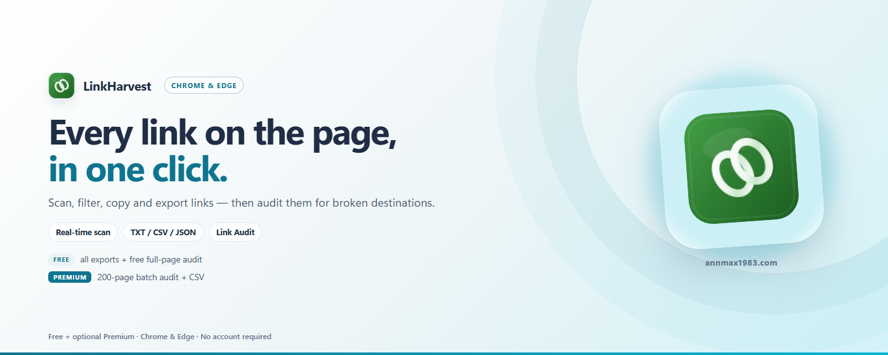

# LinkHarvest — Extracteur et analyseur de liens

[English](../README.md) | [中文](README_zh.md) | [Español](README_es.md) | [Deutsch](README_de.md) | [日本語](README_ja.md) | Français

Une extension légère qui extrait tous les liens hypertexte de n'importe quelle page web, avec filtrage intelligent, recherche, export TXT/CSV/JSON et audit de liens optionnel.

> Chrome / Edge / Firefox · Manifest V3 · Aucun suivi · Données 100 % locales

---

## Pourquoi LinkHarvest ?

La plupart des outils d'extraction de liens sont des services en ligne qui nécessitent d'envoyer le contenu de la page. LinkHarvest fonctionne entièrement dans votre navigateur — aucune donnée ne quitte votre appareil.

| Avantage | Détail |
|-----------|--------|
| 🔍 **Scan en un clic** | Extrait tous les liens `<a>` de la page courante, y compris les shadow roots ouverts et les iframes mêmes-origines imbriqués ; les iframes d'origine différente sont parcourus trame par trame |
| 🖼️ **Détection des ressources** | Un interrupteur optionnel collecte aussi `img`, `script`, feuilles de style, icônes, `iframe` et médias : une image cassée ou un script 404 ne reste plus caché derrière un `<a>` valide |
| 🏷️ **Attributs rel** | Enregistre `rel` sur chaque lien et affiche `nofollow` / `sponsored` / `ugc`, et signale `target="_blank"` sans `rel="noopener"` |
| 📡 **Surveillance DOM en temps réel** | Capte les liens ajoutés pendant le défilement (SPA, défilement infini) |
| 🔎 **Filtrage intelligent** | Filtres par inclusion/exclusion de mots-clés, tri par colonne ; filtre les ancres et pseudo-liens JS ; distingue interne/externe ; vue **dofollow uniquement** pour l'audit de liens externes |
| 💾 **Filtres enregistrés** | Nommez la combinaison de filtres actuelle et réutilisez-la en un clic (stocké localement) |
| 📋 **Copie multi-formats** | Copiez les liens filtrés en liste d'URL, Markdown, liste HTML `<a>` ou JSON Lines (gratuit) |
| 🌐 **Ouvrir dans des onglets** | Ouvrez les liens filtrés dans des onglets en arrière-plan, avec un délai réglable (gratuit) |
| 🖱️ **Menu contextuel** | Clic droit sur n'importe quelle page → « Extraire les liens de la page », pas besoin de popup |
| 🔢 **Compteur d'occurrences** | Suit combien de fois chaque URL apparaît sur la page |
| 📥 **Export JSON / TXT** | Fichier JSON structuré et liste d'URL (gratuit) |
| 📥 **Export CSV** | Encodage UTF-8 BOM — compatible avec Excel/WPS (gratuit) |
| 🩺 **Audit de liens** | Vérifie le statut HTTP des liens et signale les liens cassés, bloqués, redirigés et inaccessibles, ainsi que les ancres mortes (`#fragment` sans id correspondant) et les liens lents (2 s ou plus) ; tous les liens d'une page sont gratuits et illimités, avec un rapport CSV gratuit (⭐ Premium : audit par lot sur 200 pages maximum + un rapport CSV combiné) |
| 🎯 **Pas de faux positifs** | Les serveurs qui répondent 404 à `HEAD` mais fonctionnent en `GET` sont revérifiés en `GET` : un lien valide n'est jamais signalé comme mort |
| 🚦 **Exploration respectueuse** | Les requêtes sortantes sont limitées en débit et reculent automatiquement sur HTTP 429, pour qu'un audit volumineux ne ressemble pas à une attaque |
| 🔒 **Données locales uniquement** | Les résultats de scan restent en mémoire du navigateur (effacés à la fermeture de la page) ; les filtres enregistrés et les préférences d'interface sont stockés dans le localStorage de ce navigateur et ne sont jamais envoyés |
| 🌍 **Multilingue** | Prend en charge l'anglais, le chinois, le japonais, l'allemand, l'espagnol et le français |
| 🌙 **Mode sombre** | Suit automatiquement le thème du système |
| ⚡ **Léger** | JavaScript vanilla pur, zéro dépendance, package de moins de 100 Ko |
| 🏗️ **Manifest V3** | Utilise `activeTab` + `scripting` + `storage` + `contextMenus` — permissions minimales |

---

## Gratuit vs Premium

| Plan | Fonctionnalités |
|------|----------|
| **Gratuit** | Scan des liens (y compris shadow roots et iframes), détection optionnelle des ressources (images, scripts, feuilles de style, iframes, médias), détection rel / nofollow / noopener, surveillance DOM en temps réel, recherche et filtrage, filtres enregistrés, copie multi-formats, ouverture dans des onglets, export TXT / JSON / CSV, mode sombre, audit de tous les liens d'une page (illimité, rapport CSV inclus) |
| **⭐ Premium** | Audit par lot — vérifie tous les liens sur 200 pages maximum par exécution, à partir d'une liste d'URL collée ou d'un sitemap ; exporte un rapport CSV combiné avec codes de statut, destinations de redirection et temps de réponse ; les ancres pointant vers d'autres pages du même lot sont elles aussi validées |

Toutes les fonctionnalités de base, l'**export TXT / JSON / CSV** et l'**audit des liens d'une seule page** (avec son rapport CSV) sont gratuits à vie. L'**audit par lot sur plusieurs pages** nécessite une licence VKT Premium.

- 🛒 Obtenir une licence : `https://annmax1983.com/checkout?plugin=linkharvest`
- ⚙ L'activer : ouvrez le popup LinkHarvest → cliquez sur le bouton **⚙** → saisissez votre clé de licence.

> L'activation de la licence est **optionnelle**. Le niveau gratuit fonctionne entièrement sans elle — pas de compte, pas d'inscription, pas de clé de licence requise.

---

## Aperçu

  

---

## Navigateurs compatibles

| Navigateur | Statut |
|---------|--------|
| Google Chrome | ✅ Entièrement pris en charge |
| Microsoft Edge | ✅ Entièrement pris en charge |
| Mozilla Firefox | ✅ Entièrement pris en charge |
| Autres navigateurs basés sur Chromium | ✅ Devrait fonctionner |

> **Note Firefox :** Les autorisations de site passent par l’invite native de Firefox et peuvent être révoquées à tout moment depuis le gestionnaire de modules. Le reste des fonctions se comporte comme sous Chrome / Edge.

---

## Installation

| Store | Lien |
|---|---|
| Chrome Web Store | [Installer dans Chrome](https://chromewebstore.google.com/detail/cnkbdmjkfnlgpjehaogliipehjaibojn) |
| Microsoft Edge Add-ons | [Installer dans Edge](https://microsoftedge.microsoft.com/addons/detail/abfpbiilibfniidobemeffponimgdaff) |
| Modules complémentaires Firefox (AMO) | [Installer pour Firefox](https://addons.mozilla.org/firefox/addon/linkharvest-link/) |

> Installez uniquement depuis les boutiques officielles ci-dessus — évitez les sites de téléchargement tiers.

---

## Utilisation

1. **Ouvrez la page cible** et attendez le chargement du contenu dynamique
2. **Cliquez sur l'icône LinkHarvest** dans la barre d'outils
3. **Activez la surveillance DOM** (optionnel) — pour les pages avec défilement infini ou liens en chargement différé
4. **Cliquez sur « Scanner les liens de la page »** — tous les liens sont extraits instantanément
5. **Consultez la liste complète** — ouvre une page de résultats dédiée en vue tableau
6. **Recherchez et filtrez** — utilisez la barre de recherche, les filtres d'inclusion/exclusion de mots-clés et le tri par colonne pour affiner les résultats
   - 💾 Enregistrez cette combinaison de filtres comme préréglage nommé et réutilisez-la en un clic
   - 🌐 Ouvrez les liens filtrés dans des onglets en arrière-plan, avec un délai réglable
7. **Copiez ou exportez** — copiez les liens en URLs, Markdown, HTML ou JSON Lines (gratuit), exportez en TXT / JSON / CSV avec le compteur d'occurrences (gratuit)
8. **Lancez un audit de liens** — vérifie le statut HTTP des liens filtrés et détecte les liens cassés, bloqués, redirigés et inaccessibles ; une page est gratuite et illimitée, Premium ajoute l'audit par lot sur 200 pages maximum avec un rapport CSV combiné

---

## Champs collectés

| Champ | Description |
|-------|-------------|
| `linkText` | Texte d'affichage du lien (nettoyé) |
| `href` | URL absolue complète |
| `target` | `_blank` / `_self` |
| `category` | anchor / javascript / protocol / asset / normal |
| `kind` | `link` pour les éléments `<a>`, `asset` pour images, scripts, feuilles de style, iframes et médias |
| `assetType` | Ressources uniquement : image / script / style / frame / media |
| `rel` | L'attribut `rel` du lien sous forme de tableau (`nofollow`, `sponsored`, `ugc`, `noopener`, …) |
| `noopenerMissing` | `true` quand `target="_blank"` n'a pas `rel="noopener"` / `noreferrer` |
| `anchorId` / `anchorOk` | Ancres uniquement : l'id du fragment et si un élément avec cet id existe sur la page |
| `isInternal` | Si le lien est de même origine |
| `count` | Nombre de fois où l'URL apparaît sur la page |

---

## Confidentialité

- **activeTab** — Accorde l'accès uniquement quand vous cliquez activement sur l'icône de l'extension
- **scripting** — Utilisé pour injecter le script de collecte de liens dans la page courante
- **storage** — Stocke temporairement les résultats du scan pour la page de résultats ; effacé à la fermeture de l'onglet scanné
- **contextMenus** — Ajoute un élément de menu contextuel « Extraire les liens de la page » ; ne lit aucune donnée en soi
- **Accès optionnel aux sites (audit de liens)** — Le navigateur demande l'autorisation au lancement d'un audit. Les requêtes partent directement de votre navigateur vers chaque URL (HTTP HEAD/GET, sans cookies) ; seuls le code de statut, la destination de redirection et le temps de réponse sont conservés en mémoire. Le contenu des pages n'est ni lu ni envoyé.
- **Licence (optionnelle)** — Uniquement si vous activez une licence payante : la clé de licence et un identifiant d'installation aléatoire + des métadonnées du navigateur sont envoyées à `api.annmax1983.com` pour activer/valider la licence. Cela n'inclut jamais vos données de scan, votre historique de navigation ni vos données personnelles.
- Pas d'accès à tous les sites par défaut — l'accès est optionnel et demandé uniquement au lancement de l'audit de liens
- Pas de requêtes réseau externes en dehors de la validation optionnelle de la licence et des audits que vous lancez
- Pas d'accès à l'historique de navigation, pas de suivi utilisateur, pas d'envoi de données
- [Politique de confidentialité](privacy-policy.html)

---

## Avertissement relatif au droit d'auteur

Cette extension lit uniquement les éléments de liens hypertexte rendus publiquement (balises `<a>`) depuis les pages web pour la commodité de l'utilisateur. Tous les droits d'auteur des textes, images et contenus des sites appartiennent à leurs éditeurs originaux. L'extraction de liens ne confère aux utilisateurs aucun droit d'auteur sur le contenu des sites.

---

## Avis sur le code source

> ⚠️ **Ce dépôt sert uniquement à la présentation du projet — le code source complet n'y est pas publié.** Il ne contient que la documentation d'utilisation, les notes de version et les informations d'assistance de l'extension.

> 📥 **Téléchargement et installation uniquement depuis les boutiques officielles :** Chrome Web Store · Microsoft Edge Add-ons · Modules complémentaires Firefox (AMO). Aucun installateur hors ligne n'est distribué ici.

---

## Licence

Copyright © 2026 LinkHarvest. Tous droits réservés.

Ce logiciel est propriétaire et à code fermé. Sans autorisation écrite préalable de l'auteur, la décompilation, l'ingénierie inverse, le crackage, la modification, le reconditionnement, la redistribution ou la revente du logiciel (en tout ou en partie) sont strictement interdites.

---

## Liens

- **Site officiel:** https://annmax1983.com/
- **Cette extension:** https://annmax1983.com/extensions/linkharvest
- **Confidentialité:** https://annmax1983.com/privacy
- **Contact:** support@annmax1983.com
- **☕ Soutenir le projet (Ko-fi):** https://ko-fi.com/annmax?ref=linkharvest
