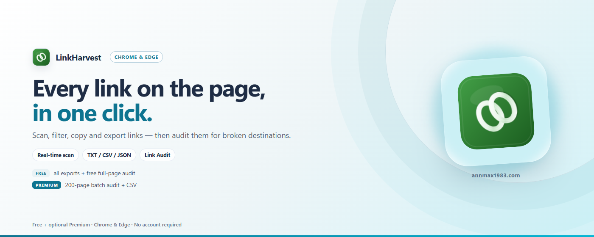

# LinkHarvest — リンク抽出＆スキャナー

[English](../README.md) | [中文](README_zh.md) | [Español](README_es.md) | [Deutsch](README_de.md) | 日本語 | [Français](README_fr.md)

任意のWebページからすべてのハイパーリンクを抽出し、スマートフィルター、検索、TXT/CSV/JSONエクスポート、オプションのリンク監査が可能な軽量ブラウザ拡張機能です。

> Chrome / Edge / Firefox · Manifest V3 · トラッキングなし · データはローカルのみ

---

## LinkHarvestの特長

ほとんどのリンク抽出ツールは、ページコンテンツのアップロードが必要なオンラインサービスです。LinkHarvestはブラウザ内で完全に動作するため、データがデバイスの外に出ることはありません。

| 特長 | 詳細 |
|-----------|--------|
| 🔍 **ワンクリックスキャン** | 現在のページからすべての`<a>`リンクを抽出。open shadow root とネストした同一オリジンのiframeも対象で、クロスオリジンのiframeはフレームごとに走査します |
| 🖼️ **リソース取得** | 任意のスイッチで`img`・`script`・スタイルシート・アイコン・`iframe`・メディアのURLも収集。壊れた画像や404のスクリプトが正常な`<a>`の陰に隠れません |
| 🏷️ **rel属性** | すべてのリンクで`rel`を記録し、`nofollow` / `sponsored` / `ugc`を可視化。`rel="noopener"`のない`target="_blank"`も検出します |
| 📡 **リアルタイムDOM監視** | スクロール中に追加されたリンクも自動で取り込み（SPA・無限スクロール） |
| 🔎 **スマートフィルター** | キーワード含む/除外フィルター、カラムソート。アンカー＆JS疑似リンクをフィルタリング、内部/外部リンクを区別。外部リンク監査向けに**dofollowのみ**の表示も可能 |
| 💾 **フィルタープリセット** | 現在のフィルター条件に名前を付けて保存し、あとからワンクリックで再利用（ローカル保存） |
| 📋 **マルチ形式コピー** | URL・Markdown・HTMLの`<a>`リスト・JSON Lines のいずれかでコピー（無料） |
| 🌐 **タブで開く** | フィルターしたリンクをバックグラウンドタブで順に開く（遅延は調整可・無料） |
| 🖱️ **コンテキストメニュー** | 任意のページを右クリック → 「ページリンクを抽出」、ポップアップ不要 |
| 🔢 **出現回数** | 各URLがページに出現する回数を追跡 |
| 📥 **JSON / TXTエクスポート** | 構造化JSONファイルとURLリスト（無料） |
| 📥 **CSVエクスポート** | UTF-8 BOMエンコーディング — Excel/WPS対応（無料） |
| 🩺 **リンク監査** | リンクのHTTPステータスを確認し、破損・ブロック・リダイレクト・到達不能を検出。さらにアンカーの欠落（`#fragment`に対応するidがない）と遅いリンク（2秒以上）も表示。1ページ内の全リンクが無料・無制限、CSVレポート付き（⭐ Pro：1回最大200ページの一括監査＋統合CSVレポート） |
| 🎯 **誤検出なし** | `HEAD`に404を返すが`GET`は正常なサーバーは`GET`で再確認。生きているリンクを死んだリンクとして報告しません |
| 🚦 **礼儀あるクロール** | 送信リクエストをレート制限し、HTTP 429では自動的にバックオフ。大きなページの監査が攻撃に見えません |
| 🔒 **データはローカルのみ** | スキャン結果はブラウザメモリにのみ保存されページ終了時にクリア。フィルタープリセットと表示設定はこのブラウザの localStorage に保存され、送信されることはありません |
| 🌍 **多言語対応** | 英語、中国語、日本語、ドイツ語、スペイン語、フランス語に対応 |
| 🌙 **ダークモード** | システムの配色設定に自動的に追従 |
| ⚡ **軽量** | バニラJavaScriptのみ、依存関係ゼロ、パッケージサイズ100KB未満 |
| 🏗️ **Manifest V3** | `activeTab`＋`scripting`＋`storage`＋`contextMenus` — 最小限の権限 |

---

## 無料版 vs Pro

| プラン | 機能 |
|------|----------|
| **無料版** | リンクスキャン（shadow root・iframe含む）、任意のリソース取得（画像・スクリプト・スタイルシート・iframe・メディア）、rel / nofollow / noopener 検出、リアルタイムDOM監視、検索＆フィルター、フィルタープリセット、マルチ形式コピー、タブで開く、TXT / JSON / CSVエクスポート、ダークモード、1ページのリンク監査（件数無制限・CSVレポート付き） |
| **⭐ Pro** | 一括監査 — 1回あたり最大200ページの全リンクをチェックし、貼り付けたURLリストまたはサイトマップから展開、ステータスコード・リダイレクト先・応答時間を含む統合CSVレポートをエクスポート。同じバッチ内の他ページを指すアンカーも検証します |

すべてのコア機能、**TXT / JSON / CSVエクスポート**、**1ページのリンク監査**（CSVレポート込み）は永久無料です。**複数ページの一括監査**にはVKT Proライセンスが必要です。

- 🛒 ライセンス取得：`https://annmax1983.com/checkout?plugin=linkharvest`
- ⚙ 有効化：LinkHarvestポップアップを開き、**⚙**ボタンをクリックしてライセンスキーを入力します。

> ライセンス有効化は**オプション**です。無料版はそれなしで完全に動作します — アカウント登録もライセンスキーも不要です。

---

## プレビュー

  

---

## 対応ブラウザ

| ブラウザ | ステータス |
|---------|--------|
| Google Chrome | ✅ 完全対応 |
| Microsoft Edge | ✅ 完全対応 |
| Mozilla Firefox | ✅ 完全対応 |
| その他のChromium系ブラウザ | ✅ 動作するはずです |

> **Firefox について：** サイトへのアクセス権限は Firefox 標準の許可ダイアログで確認し、アドオンマネージャーからいつでも取り消せます。その他の機能は Chrome / Edge と同じです。

---

## インストール

| ストア | リンク |
|---|---|
| Chrome ウェブストア | [Chrome に追加](https://chromewebstore.google.com/detail/cnkbdmjkfnlgpjehaogliipehjaibojn) |
| Microsoft Edge アドオン | [Edge に追加](https://microsoftedge.microsoft.com/addons/detail/abfpbiilibfniidobemeffponimgdaff) |
| Firefox アドオン（AMO） | [Firefox 版をインストール](https://addons.mozilla.org/firefox/addon/linkharvest-link/) |

> 上記の公式ストアからのみインストールしてください。第三者サイトの利用は避けてください。

---

## 使い方

1. **対象のWebページを開き**、動的コンテンツの読み込みを待ちます
2. ブラウザツールバーの**LinkHarvestアイコン**をクリックします
3. **DOM監視を有効化**（オプション） — 無限スクロールや遅延読み込みリンクのあるページ向け
4. **「ページリンクをスキャン」をクリック** — すべてのリンクが即座に抽出されます
5. **フルリストを表示** — テーブル表示の専用結果ページが開きます
6. **検索＆フィルター** — 検索ボックス、キーワード含む/除外フィルター、カラムソートで結果を絞り込みます
   - 💾 現在の条件を名前付きプリセットとして保存し、あとからワンクリックで再利用
   - 🌐 フィルターしたリンクをバックグラウンドタブで順に開く（遅延は調整可）
7. **コピーまたはエクスポート** — URL・Markdown・HTML・JSON Lines でコピー（無料）、TXT / JSON / CSV（出現回数付き）でエクスポート（無料）
8. **リンク監査を実行** — フィルターされたリンクのHTTPステータスを確認し、破損・ブロック・リダイレクト・到達不能なリンクを検出。1ページ内は無料・無制限、Proでは最大200ページの一括監査と統合CSVレポートを利用可能

---

## 収集されるフィールド

| フィールド | 説明 |
|-------|-------------|
| `linkText` | リンク表示テキスト（クリーニング済み） |
| `href` | 完全な絶対URL |
| `target` | `_blank` / `_self` |
| `category` | anchor / javascript / protocol / asset / normal |
| `kind` | `<a>`要素は`link`、画像・スクリプト・スタイルシート・iframe・メディアは`asset` |
| `assetType` | リソースのみ：image / script / style / frame / media |
| `rel` | リンクの`rel`属性（配列：`nofollow`、`sponsored`、`ugc`、`noopener` …） |
| `noopenerMissing` | `target="_blank"`に`rel="noopener"`/`noreferrer`がない場合`true` |
| `anchorId` / `anchorOk` | アンカーリンクのみ：フラグメントidと、そのidを持つ要素がページに存在するか |
| `isInternal` | 同一オリジンのリンクかどうか |
| `count` | そのURLがページに出現する回数 |

---

## プライバシー

- **activeTab** — ユーザーが拡張機能アイコンをアクティブにクリックした時のみアクセスを許可
- **scripting** — 現在のページにリンク収集スクリプトを注入するために使用
- **storage** — 結果ページ用にスキャン結果を一時保存。スキャンされたタブが閉じられるとクリア
- **contextMenus** — 右クリック「ページリンクを抽出」メニュー項目を追加。データ自体は読み取らない
- **オプションのサイトアクセス（リンク監査）** — 監査の開始時にブラウザが権限を要求します。リクエストはブラウザから各URLへ直接送信され（HTTP HEAD/GET、Cookieなし）、ステータスコード・リダイレクト先・応答時間のみをメモリに保持します。ページ内容の読み取りや送信は行いません。
- **ライセンス（オプション）** — 有料ライセンスを有効化した場合のみ：ライセンスキーとランダムなインストール識別子＋ブラウザメタデータが`api.annmax1983.com`に送信されてライセンスの有効化/検証が行われます。スキャンデータ、閲覧履歴、個人データが含まれることはありません。
- デフォルトでは全サイトへのアクセス権限なし — アクセスはオプションで、リンク監査の開始時にのみ要求されます
- 外部ネットワークリクエストは、オプションのライセンス検証とユーザーが開始した監査を除いて行いません
- 閲覧履歴へのアクセス、ユーザートラッキング、データアップロードなし
- [プライバシーポリシー](privacy-policy.html)

---

## 著作権に関する免責事項

この拡張機能は、ユーザーの利便性のために、Webページ上に公開されているハイパーリンク要素（`<a>`タグ）を読み取るだけです。Webサイトのすべてのテキスト、画像、コンテンツの著作権は、オリジナルの発行者に帰属します。リンクを抽出しても、ユーザーにWebサイトコンテンツの著作権が付与されるものではありません。

---

## ソースコードについて

> ⚠️ **本リポジトリはプロジェクト紹介のみを目的としており、完全なソースコードは公開していません。** 拡張機能の利用説明・リリースノート・サポート情報のみを掲載しています。

> 📥 **ダウンロードとインストールは公式ブラウザストアから：** Chrome ウェブストア · Microsoft Edge アドオン · Firefox アドオン（AMO）。本リポジトリからオフラインインストーラーを配布することはありません。

---

## ライセンス

Copyright © 2026 LinkHarvest. All rights reserved.

本ソフトウェアはクローズドソースのプロプライエタリソフトウェアです。作者の事前の書面による許諾なく、本ソフトウェアの全部または一部を逆コンパイル・リバースエンジニアリング・クラック・改変・再パッケージ・再配布・転売することを固く禁じます。

---

## リンク

- **公式サイト:** https://annmax1983.com/
- **この拡張機能:** https://annmax1983.com/extensions/linkharvest
- **プライバシーポリシー:** https://annmax1983.com/privacy
- **お問い合わせ:** support@annmax1983.com
- **☕ 開発を支援（Ko-fi）:** https://ko-fi.com/annmax?ref=linkharvest
