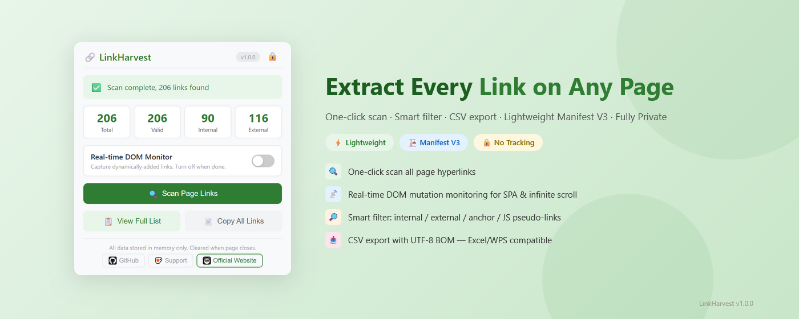

# LinkHarvest

[English](../README.md) | 中文 | [Español](README_es.md) | [Deutsch](README_de.md) | [日本語](README_ja.md) | [Français](README_fr.md)

一款轻量级浏览器扩展，可从任意网页提取全部超链接，支持智能筛选、CSV / JSON 导出与可选的链接体检。

> 基于 Chromium · Manifest V3 · 无追踪 · 数据仅存本地

---

## 功能特性

| 功能 | 说明 |
|------|------|
| 🔍 **一键扫描** | 提取当前页面所有 `<a>` 标签链接 |
| 📡 **实时 DOM 监听** | 自动捕获浏览过程中新增的链接（SPA、无限滚动） |
| 🔎 **智能筛选** | 关键词包含/排除、列排序；过滤锚点与 JS 伪链接；区分站内/站外 |
| 💾 **筛选预设** | 把当前筛选组合命名保存，下次一键复用（仅存本地） |
| 📋 **多格式复制** | 以纯 URL、Markdown、HTML 的 `<a>` 列表或 JSON Lines 复制筛选结果（免费） |
| 🌐 **批量打开** | 把筛选出的链接在后台标签页依次打开，延迟可调（免费） |
| 🖱️ **右键菜单** | 页面右键"提取本页链接"，无需打开弹窗 |
| 🔢 **出现次数** | 统计每个 URL 在页面中出现的次数 |
| 📥 **JSON / TXT 导出** | 结构化 JSON 文件与纯 URL 列表（免费） |
| 📥 **CSV 导出** | UTF-8 BOM 编码，兼容 Excel/WPS（免费） |
| 🩺 **链接体检** | 检测筛选结果的 HTTP 状态，标记失效、拦截、重定向与无法访问的链接；每次可免费预览 100 条（⭐ 高级版：最多 2,000 条 + CSV 报告） |
| 🔒 **数据仅存本地** | 扫描结果仅存于浏览器内存（关页面即清空）；筛选预设与界面偏好保存在本机 localStorage，永不上传 |
| 🌍 **多语言** | 支持中文、英文、日文、德文、西班牙文、法文 |
| 🌙 **暗色模式** | 自动跟随系统主题 |
| ⚡ **轻量** | 纯原生 JavaScript，零依赖，包体 < 100KB |
| 🏗️ **Manifest V3** | 仅需 `activeTab` + `scripting` + `storage` + `contextMenus` 最小权限 |

---

## 免费 vs 付费

| 方案 | 功能 |
|------|------|
| **免费版** | 扫描链接、实时 DOM 监听、搜索筛选、筛选预设、多格式复制、批量打开、TXT / JSON / CSV 导出、暗色模式、链接体检预览（每次 100 条） |
| **⭐ 高级版** | 完整链接体检 — 每次最多 2,000 条，并导出包含状态码、重定向地址与响应时间的 CSV 体检报告 |

所有核心功能与 **TXT / JSON / CSV 导出**永久免费。**链接体检预览**免费；**完整体检与报告**需要 VKT 高级版许可证。

- 🛒 获取许可证：`https://www.annmax1983.com/checkout.html?plugin=linkharvest`
- ⚙ 激活：打开 LinkHarvest 弹窗 → 点击 **⚙** 按钮 → 输入许可证密钥

> 许可证激活是**可选的**。免费版无需任何账户或许可证即可正常使用。

---

## 预览

  

---

## 支持的浏览器

| 浏览器 | 状态 |
|--------|------|
| Google Chrome | ✅ 完全支持 |
| Microsoft Edge | ✅ 完全支持 |
| 其他 Chromium 内核浏览器 | ✅ 应可使用 |

---

## 安装

| 商店 | 链接 |
|---|---|
| Chrome 应用商店 | [在 Chrome 中安装](https://chromewebstore.google.com/detail/cnkbdmjkfnlgpjehaogliipehjaibojn) |
| Microsoft Edge 加载项 | [在 Edge 中安装](https://microsoftedge.microsoft.com/addons/detail/abfpbiilibfniidobemeffponimgdaff) |

> 请只通过上方官方商店安装，避免使用第三方下载站。

---

## 使用方法

1. **打开目标网页**，等待动态内容加载完成
2. **点击工具栏中的 LinkHarvest 图标**
3. **开启 DOM 监听**（可选）— 适用于无限滚动或延迟加载链接的页面
4. **点击「扫描当前页面链接」** — 即时提取所有链接
5. **查看完整列表** — 打开独立结果页面，表格形式展示
6. **搜索与筛选** — 使用搜索框、关键词包含/排除和列排序精简结果
   - 💾 保存为命名预设（💾），下次一键复用
   - 🌐 在后台标签页批量打开筛选结果（🌐），延迟可调
7. **复制或导出** — 以纯 URL、Markdown、HTML 或 JSON Lines 复制（免费）、导出 TXT / JSON / CSV 含出现次数（免费）
8. **运行链接体检** — 检测筛选链接的 HTTP 状态，快速定位失效、拦截、重定向与无法访问的链接；免费预览每次 100 条，高级版最多 2,000 条并可导出 CSV 报告

> **⚠️ CSV 导出风险提示：** 导出的 CSV 文件将保存至您的设备本地磁盘。该文件由您自主管理，插件不控制本地导出文件的生命周期。如不再需要，请手动删除导出文件。

---

## 采集字段

| 字段 | 说明 |
|------|------|
| `linkText` | 链接显示文本（已清洗） |
| `href` | 完整绝对 URL |
| `target` | `_blank` / `_self` |
| `category` | 锚点 / JavaScript 伪链接 / 协议链接 / 普通链接 |
| `isInternal` | 是否为同源站内链接 |
| `count` | 该 URL 在页面中出现的次数 |

---

## 隐私

- **activeTab** — 仅在您主动点击扩展图标时授予当前标签页的临时访问权限
- **scripting** — 用于向当前页面注入链接采集脚本
- **storage** — 临时存储扫描结果，关闭标签页后清除
- **contextMenus** — 添加“提取本页链接”右键菜单入口，本身不读取任何数据
- **网站访问权限（可选，仅链接体检）** — 首次体检时浏览器会询问是否允许访问目标网站。请求由浏览器直接发往每个 URL（HTTP HEAD/GET，不带 Cookie），仅在结果页内存中保留状态码、重定向地址与响应时间；不读取或上传网页内容。
- **许可证（可选）** — 仅在激活付费许可证时发送许可证密钥和随机安装标识至 `api.annmax1983.com`，不做额外请求
- 默认不申请全站访问权限；仅在您主动开始链接体检时申请可选权限
- 除可选的许可证校验与您主动发起的链接体检外，不发起外部网络请求
- 不访问浏览历史，不追踪用户，不上传数据
- 扫描结果仅保存在浏览器内存中，关闭页面后自动清除；筛选预设与界面偏好保存在本机 `localStorage`，同样不会上传
- [Privacy Policy](../privacy-policy.html)

### 未申请的权限

| 权限 | 不申请原因 |
|------|-----------|
| 全站常驻访问权限 | 网站访问是可选权限，仅在您开始链接体检时申请 |
| `notifications` | 不发送系统通知 |
| `cookies` | 不读取或修改 Cookie |
| `webRequest` | 不拦截或监听网络请求 |

### 不采集的数据

- ❌ 页面密码、表单输入内容
- ❌ Cookie、LocalStorage、IndexedDB、SessionStorage 数据
- ❌ 浏览器缓存、浏览历史
- ❌ 用户身份凭证、登录信息
- ❌ 页面正文文本、图片、视频等媒体内容
- ❌ 第三方脚本数据、广告追踪信息
- ❌ 设备标识符、IP 地址、用户行为数据

### 用户权利（GDPR/CCPA 合规）

- **停止权**：您可随时关闭插件或停止扫描操作
- **删除权**：关闭页面或浏览器后，所有内存数据自动清除；您也可随时手动删除本地导出的 CSV / JSON 文件
- **查阅权**：本插件不存储任何可识别用户身份的数据，无可供查阅的用户数据
- **数据可携权**：CSV / JSON 导出功能已支持数据导出
- **退出权**：本插件不涉及任何数据追踪或画像行为，无需额外退出操作

---

## 版权声明

本扩展仅读取网页中公开渲染的超链接元素（`<a>` 标签），为用户提供便捷的链接提取服务。网站所有文字、图片等内容版权归原始发布者所有。提取链接不授予用户对网站内容的任何版权授权。

### 使用限制

用户不得借助本插件：

- 实施违反目标网站服务条款的高频批量爬虫或数据抓取
- 进行违反知识产权法律的资源批量下载
- 从事大规模未经授权的版权内容转载或分发
- 违反目标网站 `robots.txt` 协议或用户协议

建议用户在批量提取链接前，查阅目标站点的 `robots.txt` 及用户使用协议。因不当使用造成的相关违规责任由用户自行承担。

用户在使用提取的链接时应遵守当地知识产权法律。

---

## 源码说明

> ⚠️ **此处不发布源码。** 本仓库仅提供使用说明、更新日志和留言支持服务。扩展程序仅通过 Chrome Web Store 分发，不提供离线安装包或终端用户源代码。

---

## 许可证

Copyright © 2026 LinkHarvest. 保留所有权利。

本项目基于 [MIT 许可证](../LICENSE) 开源。您可以按照许可条款自由使用、修改和分发本软件。

---

## 审核说明

供应用商店审核人员参考，本扩展声明如下：

| 项目 | 详情 |
|------|------|
| 申请的权限 | `activeTab`、`scripting`、`storage`、`contextMenus` |
| `activeTab` 用途 | 用户点击扩展图标（或右键菜单）时临时访问当前标签页 |
| `scripting` 用途 | 用户触发扫描时注入链接采集脚本 |
| `contextMenus` 用途 | 添加"提取本页链接"右键菜单项 |
| 网络请求 | 免费功能无网络请求；仅在激活付费许可证时连接许可证服务器 |
| 数据存储 | 扫描结果临时存于 `chrome.storage.session`（仅内存，不落盘），被扫描标签页关闭后自动删除 |
| 第三方服务 | 仅付费许可证验证（`api.annmax1983.com`），免费功能不连接 |
| 用户追踪 | 无 |
